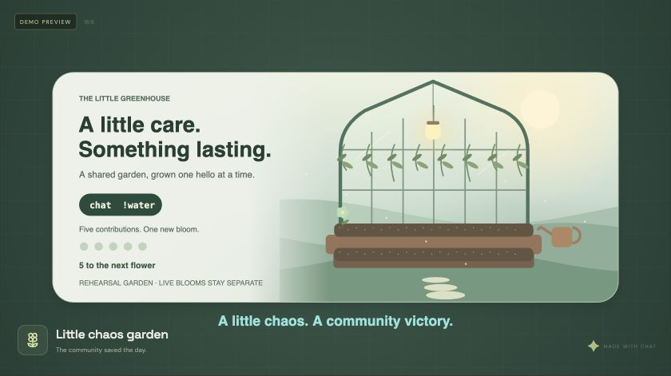
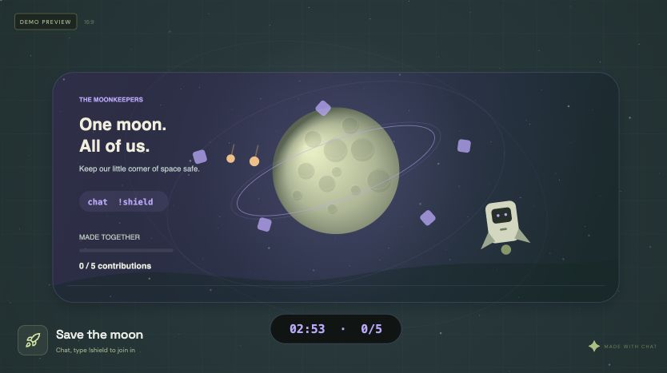
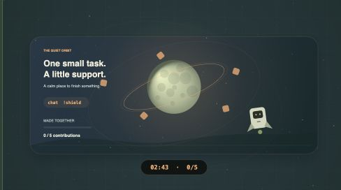
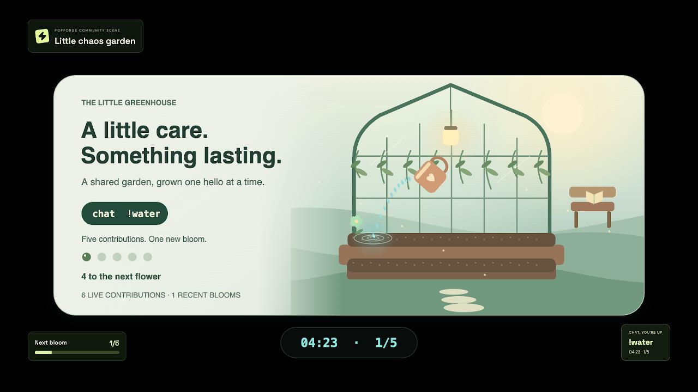
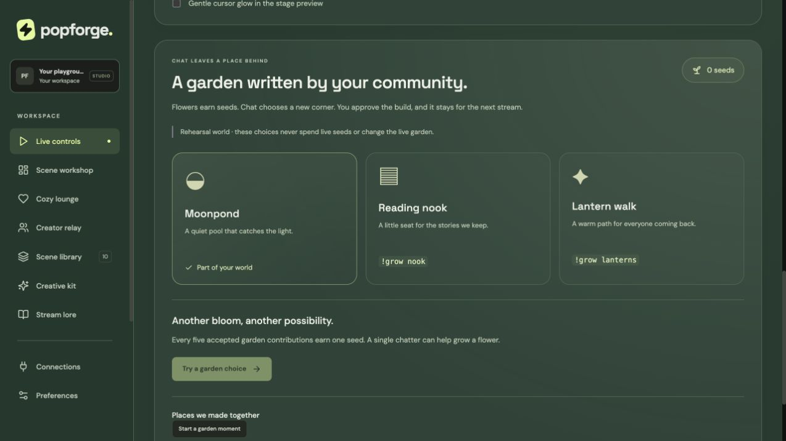
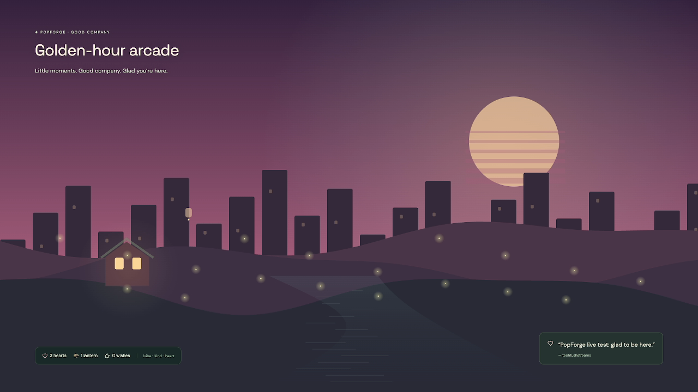
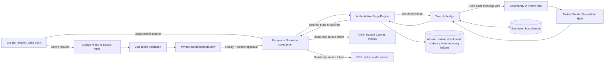

<p align="center">
  
</p>

# PopForge

**Your chat imagines it. Your stream plays it.**

Turn a creator’s queue or coffee break into a shared community moment: a playable scene, a lasting garden, and a welcoming room. Viewers stay in Twitch chat. The creator stays in OBS.

| Important link | What you’ll find |
| --- | --- |
| [GitHub repository](https://github.com/TusharTechs/popforge) | Complete source, original assets, tests, and setup instructions; currently private |
| [Hosted studio preview](https://popforge-studio.tusharaggarwal274.chatgpt.site/) | Public, browser-only preview; live Twitch/OBS uses the local companion |
| [Quick start](#quick-start) · [Live setup](docs/SETUP.md) | Credential-free evaluation, Twitch connection, OBS video/audio, troubleshooting |
| [Guided rehearsal](https://popforge-studio.tusharaggarwal274.chatgpt.site/pilot) | Four timed, observer-reported tasks; self-rehearsal first, no background telemetry |
| [Production roadmap](docs/PRODUCTION_GATE.md) | What remains before a hosted multi-creator service |
| [Architecture](docs/ARCHITECTURE.md) | Mermaid system and sequence diagrams, modules, trust boundaries, persistence |
| [Verification evidence](judging/EVIDENCE.md) | Automated checks, real Twitch, runtime Codex generation, actual OBS capture |
| [Final judging review](judging/FINAL_REVIEW.md) | Human-style and AI-style assessments against all four official criteria |
| [Submission checklist](judging/SUBMISSION_CHECKLIST.md) | Exact remaining deliverables, access requirements, and form fields |
| [Submission write-up](judging/SUBMISSION_DRAFT.md) · [Demo plan](judging/DEMO_AND_PILOTS.md) | Ready-to-adapt project description and an under-three-minute recording sequence |
| [Hackathon](https://twitchcon-codex.devpost.com/) · [Rules](https://twitchcon-codex.devpost.com/rules) · [Resources](https://twitchcon-codex.devpost.com/resources) | Official Codex × TwitchCon Hackathon information |
| Project Devpost page | Not created/verified in the connected account; add the actual project URL before submitting |
| YouTube demonstration | In preparation; add the final publicly accessible video URL before submitting |
| [MIT license](LICENSE) · [Third-party notices](THIRD_PARTY_NOTICES.md) | Project reuse terms, dependency notices, original music permission |

**Built end to end with OpenAI Codex.** The creator supplied the concept, product direction, feedback, accounts, and live test participation. Codex implemented the application, Twitch integration, scene runtime, original procedural visuals and music tooling, tests, debugging, OBS setup assistance, and documentation throughout this build. PopForge also uses the genuine Codex SDK at runtime for optional scene creation. Third-party frameworks and SDKs retain their own authorship and licenses.

Development session: **`01a18204-be62-77d1-b0ad-70175ae80ee7`**. Runtime generation evidence: **`01a18c7c-4f21-76f1-a43a-f29d7ddb22bd`**. The main development ID belongs in the submission form.

## The experience

A creator has a few minutes of dead air. They choose **Grow a garden**, select a gentle pace, and start. Chat sends `!water` or `!plant sunset`; the OBS scene responds. Every five accepted live garden contributions adds a flower to the community’s persistent garden. When the creator returns, the controls are beside OBS. A late viewer types `!recap` to learn what happened and how to join in.

One chatter can complete a gentle five-contribution moment by returning after each cooldown. Busy communities get a larger goal and bounded visual effects. This supports participation at different chat activity levels; production audience capacity and retention improvements have not been measured.

| For the creator | For the community |
| --- | --- |
| Three quick-start moments and a compact OBS dock | Free commands in the Twitch chat they already use |
| Private preview, explicit publication, and rollback | A garden that remembers their contributions |
| Breather, pause/resume, end activity, and quiet controls | Cooperative games, scene proposals, polls, and gentle reactions |
| Optional original soundscapes and break nudges | A grounded recap and moderated words of kindness |



The garden now has an illustrated greenhouse even before the first contribution. Earned flowers and rehearsal progress remain separate. The refreshed space scenes give cooperative defense and focus their own atmosphere.

| Moonkeepers | Quiet orbit |
| --- | --- |
|  |  |

[Earlier OBS capture evidence](judging/EVIDENCE.md#actual-obs-recording) documents the prior renderer; it is retained as historical evidence.

## How PopForge meets the judging criteria

| Criterion | Concrete implementation | Evidence and practical boundary |
| --- | --- | --- |
| **Innovation/Idea** | Combines streamer-approved scene co-creation, short chat games, a persistent community world with creator-approved building votes, and catch-up lore in one OBS workflow | Codex-generated Purple Community Garden was previewed and published. Four trusted mechanics support ten presets; this is bounded scene generation |
| **Potential Impact** | Viewers use Twitch directly without a PopForge account; gentle moments are playable by one chatter; creators have clear break/return controls | Separate-account Twitch commands and a single-chatter automated scenario passed. Independent adoption and viewer-retention studies remain future work |
| **Technological implementation** | Real OAuth/EventSub, authoritative Socket.io state, validated Codex SDK output, role-separated sources, encrypted local identity, durable source links | 51 tests, successful production build, real OAuth restart, runtime generation, and recorded OBS output; detailed evidence is linked above |
| **Design** | Original cozy environments, accessible custom dropdowns, startup logo animation, four studio themes, reduced motion, bounded particles, original music, and an OBS dock | Browser and OBS checks completed. The rehearsal audio is quiet; final narration/music balance needs listening QA |

The official criteria are equally weighted. These are implementation mappings, not claims about an official score or a guaranteed result.

## Quick start

Requires **Node.js 22+** and npm. macOS Apple Silicon is the platform exercised with real Twitch and OBS; other operating systems have not been live verified.

```sh
git clone https://github.com/TusharTechs/popforge.git
cd popforge
npm ci
cp .env.example .env
npm run dev
```

Open **http://localhost:4317**. Recipe mode, scenes, lounge, original music, polls, and local recaps work without Twitch or AI credentials. Anyone can also try the public hosted preview without a PopForge account: start a moment and use its clearly labeled browser-only sample contribution button. For labeled synthetic chat rehearsal, open **http://localhost:4317/?lab=1**. Keep rehearsal separate from claims about actual Twitch traffic.

For a production local build:

```sh
npm run build
npm start
```

For automated checks:

```sh
npm test
npm run build
# With the companion already running:
npm run verify:local
```

`npm run dev:frontend` provides a separate browser-only preview at port **4318**. That mode synchronizes tabs in the same browser profile using localStorage/BroadcastChannel; the local companion uses server-authoritative sockets across studio and OBS browser profiles.

**Setup assistant:** Connections offers a downloadable OBS starter collection with separate picture/sound sources. It imports as a separate collection, leaves output profile settings alone, and does not start broadcasting. Sound still needs explicit activation. Keep the downloaded file private because it contains read-only source links.

**Live setup:** follow [docs/SETUP.md](docs/SETUP.md) to register the Twitch application, configure `.env`, authorize the broadcaster, and add visual/audio sources to OBS. The service binds to `127.0.0.1`. Do not expose it as a public web server.

## What’s implemented

### Live controls and co-creation

- Three quick-start moments: garden, moon defense, and focus sprint. Choose 1, 3, or 5 minutes and a gentle 5-contribution or lively 25-contribution goal. An active moment cannot be accidentally replaced.
- Scene workshop with ten presets across reactor, meteor defense, garden, and focus. Deterministic **Recipe remix** is an explicitly selected, account-free mode; **Codex SDK** is a separate genuine generation path.
- A private preview must report renderer readiness before publication. Published state updates the existing browser source without reloading its route. The last three scene definitions support rollback.
- Free chat polls last 45 seconds: one choice per account, changes allowed. Chat proposals enter a bounded queue; the creator approves what reaches the stream. These are application polls, not native Twitch Predictions or Channel Point transactions.
- Pause/resume, end activity, quiet mode, and a breather that never auto-returns the creator. Focus-task success requires explicit creator confirmation; a timer or cheer goal does not verify real-world work.

### Community memory and catch-up

- Accepted live garden contributions accumulate; every five grows a flower. `!plant mint`, `!plant moon`, or `!plant sunset` chooses the color when completing a set. The latest 24 flowers and live contribution total persist across restarts and fresh sessions.
- Synthetic rehearsal has its own garden. Duplicate events, idle commands, and cooldown violations cannot inflate live progress.
- A recap selects up to three events from the bounded event log and approved creator notes. `!recap` replies directly in Twitch chat, with a channel-wide 30-second reply cooldown. It does not invent gameplay, infer inside jokes from video, or transcribe a broadcast.

Accepted garden commands now have distinct 4.5-second responses: `!water` moves and tips a heart mug, pours droplets, and sends ripples through the soil; `!plant mint`, `moon`, or `sunset` drops a seed and sprouts colored leaves; `!cheer` adds a warm sparkle. A new earned flower grows into view. Reduced motion and quiet mode use a static highlight instead. At most three recent care cues render together; duplicate, idle, or cooldown-rejected messages cannot trigger a care animation.



### A world chat leaves behind

Each five-contribution bloom earns a seed. Chat chooses `!grow pond`, `!grow nook`, or `!grow lanterns` during a 45-second choice. One account has one changeable choice; broadcaster votes are excluded. The creator closes the choice and explicitly approves the build. Ties and empty choices spend nothing. Moonpond, Reading nook, and Lantern walk become visible places in the garden and appear in catch-up context. Live places survive fresh sessions and companion restarts. Browser rehearsal survives reload but clears on rehearsal reset. These are three authored landmarks, not an unbounded generated world. Viewers see the live choices, exact chat commands, counts, and countdown directly on the OBS scene. A clear winner waits for creator approval; building reveals the new place for twelve seconds. The same open/close/build controls are available in the compact OBS dock.



### Cozy Lounge, music, and creative assets

- Four original Canvas environments: Starlit hideaway, Rainy window, Aurora drift, and Golden-hour arcade. The creator decides whether they become a full OBS background.
- Hearts, lanterns, stars, bounded celebration particles, a persistent kindness jar, community mood suggestions, and a kindness approval queue. Mood suggestions never change the environment without creator approval.
- Optional procedural Web Audio, filtered rain/night air, and three original synthesized WAV loops: **Moonlit Desk**, **Peach Tea**, and **Aurora Drift**. Start sound explicitly in OBS Interact; use one playback surface to avoid doubling.
- Quiet energy, reduced motion, adjustable effects, private opt-in break nudges, keyboard-operable custom dropdowns, Forest/Plum/Ocean/Charcoal themes, and a startup animation tied to actual initialization.
- Six customizable SVG asset types in three palettes, including title cards, panels, and transparent webcam frames. Cursor glow is optional, limited to the studio preview, and suppressed for reduced motion/coarse pointers.



### Creator Relay — prototype

Two creators explicitly approve a shared episode; each community contributes up to 50% of the decision, so raw chat size cannot dominate the other side. One Twitch identity has one choice across both communities; broadcaster accounts are excluded. Disconnect pauses the episode, either creator can withdraw, and a raid remains a manual native Twitch action.

Current invitations are localhost-only and require the same computer. Guest credentials and episode ledgers are memory-only. Remote collaboration, discovery, and real two-broadcaster validation remain unfinished. The internal load lab measures engine behavior, not Twitch viewers, network capacity, or growth.

## Viewer command guide

| Command | Result |
| --- | --- |
| `!water` | Contribute during a garden round |
| `!plant mint` / `!plant moon` / `!plant sunset` | Garden contribution; chooses the flower color when completing a five-contribution set |
| `!shield` / `!cheer` | Contribute during an active cooperative round; 3-second per-account cooldown |
| `!heart` / `!hug`, `!glow`, `!star`, `!hype` | Cozy reactions; 4-second encouragement cooldown and bounded bursts |
| `!vibe starlight` / `rain` / `aurora` / `sunset` | Suggest an atmosphere; the creator applies it |
| `!kind your message` | Submit a kindness note for creator approval |
| `!grow pond` / `!grow nook` / `!grow lanterns` | Choose an available corner during an open community-world vote |
| `!vote 1` / `!vote 2` / `!vote 3` | Vote in an open application poll |
| `!forge your idea` | Propose a scene for creator review |
| `!recap` | Receive a short event-grounded recap in Twitch chat |
| `!relay 1` / `!relay 2` / `!relay 3` | Choose during an approved, active Relay episode |

## Architecture



The complete [architecture guide](docs/ARCHITECTURE.md) explains the scene-publication sequence, renderer boundary, local authorization, persistence, restart semantics, bounded data, and module map.

## Built with Codex, from idea to verification

Codex served as the end-to-end implementation agent throughout the project: translating the creator’s idea into a runnable product; writing frontend/backend code, Twitch connections, procedural visuals and music tooling; adding regression tests; diagnosing live integration issues; helping configure OBS; and preparing reproducible documentation. Human direction, credential entry, product feedback, and real chatter participation stayed with the creator.

There is also an optional **runtime Codex SDK** pipeline:

1. The creator requests a scene; the server starts a genuine `@openai/codex-sdk` thread.
2. Generation uses structured JSON schema output in an isolated working directory with a read-only sandbox, no web search, network disabled, and a 90-second timeout. Twitch secrets are excluded from the subprocess environment.
3. Zod validates the returned specification again. Only four trusted mechanics and bounded parameters are accepted; arbitrary generated JavaScript is never executed.
4. The creator inspects the private preview and explicitly publishes. Errors stay errors; they do not silently turn into fake AI results.

A real request generated **Purple Community Garden in 14.0 seconds**, then passed preview readiness and publication. That is one measured run, not a latency guarantee. An installed Codex CLI resolved a compatibility failure in the SDK-bundled CLI without changing the configured account model. `CODEX_CLI_PATH` can override executable selection.

See [evidence](judging/EVIDENCE.md) for the development/runtime session distinction and verified limits. Runtime generation is optional and can use an account allowance; recipe mode evaluates the interactive experience without AI credentials.

## Technical and privacy boundaries

The full product is a **local, single-broadcaster companion** plus a public hosted preview. The hosted preview does not provide the Twitch backend. Viewers need no PopForge account because participation happens through Twitch.

- Studio controls use a local HttpOnly session; read-only visual/audio sources have a separate token. Viewer sockets cannot mutate state even when their browser shares a studio cookie. Source links survive restarts and can be explicitly revoked.
- Host credentials use AES-256-GCM with owner-only identity files and a separate local key. This is not an OS keychain: someone controlling the same OS account can read both files. Disconnect forgets saved authorization locally; Twitch consent revocation is separate.
- Public state snapshots omit pending proposals and the kindness moderation queue. Recent public Twitch chat can still contain the original command text. State retains up to 50 chat messages, 80 events, and 10 proposals.
- Restarts restore the host connection, stable source identity, and bounded private recovery ledgers. Active rounds return to standby; ordinary open polls close. World choices resume only with a consistent recovered ledger. Relay guests must reconnect. Checkpoints are owner-only, checksummed, atomically replaced, and errors are surfaced. See the recovery limits in the architecture guide.
- Optional browser speech recognition detects one keyword after permission. It is not stream transcription; processing may use the browser’s speech service.
- No Bits wagering, Channel Point payouts, native Predictions, automatic game/bounty verification, public Twitch Extension, or public multi-tenant service is implemented. No passive viewer identification or guaranteed retention/growth is claimed.

Read [KNOWN_LIMITATIONS.md](KNOWN_LIMITATIONS.md) before evaluating deployment, privacy, or scale.

## Verification and submission status

**Verified through 31 October 2026:** 51 tests pass; TypeScript/Vite production build succeeds; npm audit reports zero known dependency vulnerabilities in the locked dependency set. Real Twitch OAuth/EventSub, separate-chatter commands, host restoration, runtime Codex generation, OBS dock/source setup, and a 35.43-second audiovisual recording have evidence. The recording is **1280 × 720 at 30 fps**, with non-silent 48 kHz stereo AAC. Its quiet music mix needs a final listening check. Twitch broadcasting stayed off during rehearsal.

The 31 October visual pass adds a greenhouse garden, distinct cosmic mission scenes, a warmer studio, mobile captions below the artwork, and a sample contribution button in the public browser preview. The application bundle is now approximately 211 KB plus a separate 373 KB vendor bundle (minified); the earlier 500 KB chunk warning is resolved. This improves cache separation; startup speed has not been benchmarked. An isolated transport rehearsal accepted 500 synthetic actions with 20 local reader sockets, all converging; this is not Twitch audience capacity. A real second-account garden → seed → Reading nook vote → creator build → OBS reveal → Twitch recap loop also passed, and the built place restored after a real companion restart. Watering and moon-plant animations were subsequently captured from real chat commands. Independent creator pilots, remote Relay, and Internet-scale testing remain future work.

The final YouTube video, Devpost project/submission, private repository judge access, and confirmation of entrant declarations are outstanding. Follow [the submission checklist](judging/SUBMISSION_CHECKLIST.md); the public browser preview alone is insufficient judge access.

## License and acknowledgments

PopForge’s original application code and artwork are released under the [MIT License](LICENSE). Original instrumental recordings additionally carry explicit stream/VOD reuse permission in [public/music/LICENSE.txt](public/music/LICENSE.txt). Dependencies keep their own licenses; see [THIRD_PARTY_NOTICES.md](THIRD_PARTY_NOTICES.md).

Built for the **Codex × TwitchCon Hackathon**. Independent project; not an official Twitch or OpenAI product. Twitch and OpenAI names identify the integrations and event; no endorsement is implied.
