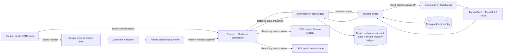

<p align="center">
  
</p>

# PopForge

[](https://github.com/TusharTechs/popforge/actions/workflows/ci.yml)

**Your chat imagines it. Your stream plays it.**

PopForge turns a streamer's queue, coffee break, or quiet moment into something the whole chat builds together: a playable scene in OBS, a community garden that keeps growing across streams, and a cozy room to come back to. Viewers just type in Twitch chat. The creator stays in OBS. Built with OpenAI Codex.

| Link | What you'll find |
| --- | --- |
| Demo video | _YouTube link added at submission_ |
| [Hosted studio preview](https://popforge-studio.tusharaggarwal274.chatgpt.site/) | Try the studio in a browser, no install or account |
| [Quick start](#quick-start) · [Live setup](docs/SETUP.md) | Run locally, connect Twitch, add PopForge to OBS |
| [How Codex built it](docs/BUILT_WITH_CODEX.md) | Timeline of the Codex thread, plus Codex running inside the product |
| [Architecture](docs/ARCHITECTURE.md) | Mermaid diagrams, module map, trust boundaries |
| [Evidence](judging/EVIDENCE.md) | Real Twitch, OBS, and runtime Codex test records |
| [Known limitations](KNOWN_LIMITATIONS.md) · [Production roadmap](docs/PRODUCTION_GATE.md) | Current scope and what a hosted service needs |
| [MIT license](LICENSE) · [Third-party notices](THIRD_PARTY_NOTICES.md) | Reuse terms, dependencies, music permission |

**Codex session ID:** `01a18204-be62-77d1-b0ad-70175ae80ee7`

## The experience

A streamer needs five minutes away from the keyboard. They pick **Grow a garden** and press start. Chat types `!water` and a mug tips over and pours into the soil. Someone types `!plant sunset` and a seed drops in. Every five contributions, a new flower grows, and it is still there next stream.

Flowers earn seeds. Chat votes on what to build next (`!grow pond`, `!grow nook`, `!grow lanterns`), the streamer approves it, and a new place appears in the community's garden for good. When the streamer comes back, a late viewer types `!recap` and PopForge replies in chat with what they missed.


| Moonkeepers | Quiet orbit |
| --- | --- |
|  |  |

| For the creator | For the community |
| --- | --- |
| Three one-click moments and a compact OBS dock | Free commands in the Twitch chat they already use |
| Private preview, then publish, with rollback | A garden that remembers their contributions |
| Breather, pause, quiet mode, and break nudges | Co-op games, scene ideas, polls, and gentle reactions |
| Codex turns an idea into a new scene on the spot | A recap so late viewers can join right in |

## How PopForge meets the judging criteria

| Criterion | What PopForge does |
| --- | --- |
| **Innovation** | Chat leaves something behind. Contributions grow a garden that persists across streams, earned seeds let chat vote on new landmarks, and the creator approves each build. Codex can turn a creator's idea into a new playable scene during the stream. |
| **Potential impact** | Works for a chat of one or a busy one: gentle 5-contribution goals scale up to 25 contributions with bounded effects. Viewers need no extra account or app. Creators get breaks they can actually take, without dead air. |
| **Technical implementation** | Twitch OAuth with EventSub chat, server-authoritative Socket.io state, sandboxed and schema-validated Codex SDK generation, encrypted local identity, atomic crash-safe persistence, and 51 automated tests in CI. Built mainly in one Codex thread. |
| **Design** | Original hand-built Canvas art and music, four studio themes, an OBS dock, keyboard-friendly controls, reduced motion and quiet modes, and on-screen instructions so viewers always know what to type. |

## Quick start

Requires **Node.js 22+**. Tested live on macOS (Apple Silicon) with Twitch and OBS 33.

```sh
git clone https://github.com/TusharTechs/popforge.git
cd popforge
npm ci
cp .env.example .env
npm run dev
```

Open **http://localhost:4317**. Scenes, the lounge, music, polls, and recaps all work without Twitch or AI credentials. Open **http://localhost:4317/?lab=1** to simulate chat.

To go live, follow [docs/SETUP.md](docs/SETUP.md): register a Twitch app, add its ID and secret to `.env`, sign in as the broadcaster, and import the OBS starter collection from **Connections**.

```sh
npm test            # 51 regression tests
npm run build       # typecheck + production bundle
npm run verify:local  # with the companion running: secret-free readiness report
```

## Features

### Live moments and co-creation

- **Three quick starts:** grow a garden, defend the moon, or a focus sprint. Pick 1, 3, or 5 minutes and a gentle or lively goal.
- **Scene workshop:** ten presets across four mechanics. **Recipe remix** works offline; **Codex SDK** generates a new scene from a written idea.
- **Preview before publish:** scenes render privately first, publish to OBS without reloading the source, and the last three can be rolled back.
- **Chat polls and proposals:** 45-second polls with one changeable vote per viewer; `!forge` ideas queue up for the creator to approve.
- **Creator controls:** pause/resume, end activity, quiet mode, and a breather that waits until the creator is ready.

### Community memory

- Every five garden contributions grow a flower; `!plant mint`, `moon`, or `sunset` picks its color. Flowers persist across restarts and new streams.
- Each flower earns a seed. Chat chooses a new place (Moonpond, Reading nook, or Lantern walk), the creator approves it, and OBS shows a 12-second reveal. Votes, counts, and the countdown appear on stream.
- `!recap` replies in Twitch chat with up to three real recent events and any notes the creator approved.
- Each command gets its own animation: `!water` tips a mug and ripples the soil, `!plant` drops a seed and sprouts colored leaves, `!cheer` adds a warm sparkle.


### Cozy Lounge, music, and creative kit

- Four original Canvas environments: Starlit hideaway, Rainy window, Aurora drift, and Golden-hour arcade.
- Hearts, lanterns, stars, a kindness jar with creator moderation, and mood suggestions the creator can apply.
- Procedural Web Audio plus three original synthesized loops (**Moonlit Desk**, **Peach Tea**, **Aurora Drift**), cleared for stream and VOD use.
- Forest, Plum, Ocean, and Charcoal themes, reduced motion, an animated startup screen, and private break nudges.
- Downloadable SVG title cards, panels, and transparent webcam frames in three palettes.


### Creator Relay (prototype)

Two creators run a shared episode. Each community gets at most half of the decision, so a bigger chat can't drown out a smaller one. Both creators approve, either can withdraw, and a disconnect pauses the episode. It currently runs with both creators on the same computer.

## Viewer commands

| Command | What it does |
| --- | --- |
| `!water` | Contribute during a garden moment |
| `!plant mint` / `moon` / `sunset` | Contribute and choose the next flower's color |
| `!shield` / `!cheer` | Help during a co-op round (3-second cooldown) |
| `!heart` / `!hug`, `!glow`, `!star`, `!hype` | Cozy reactions |
| `!vibe starlight` / `rain` / `aurora` / `sunset` | Suggest an atmosphere |
| `!kind your message` | Send a kindness note for the creator to approve |
| `!grow pond` / `nook` / `lanterns` | Vote on the next community place |
| `!vote 1` / `2` / `3` | Vote in a poll |
| `!forge your idea` | Suggest a scene |
| `!recap` | Get a short recap in chat |
| `!relay 1` / `2` / `3` | Choose during a Relay episode |

## Architecture



The [architecture guide](docs/ARCHITECTURE.md) covers scene publishing, the renderer boundary, local authorization, persistence, and restart behavior.

## Built with Codex

PopForge was built mainly in one Codex Desktop thread over four days. The creator set the direction, tested live as both streamer and chatter, and sent screenshots of anything that looked wrong. Codex wrote the frontend, backend, Twitch integration, art, music tooling, and tests, then checked its own work in a browser, against real Twitch chat, and in OBS. [Read the full timeline →](docs/BUILT_WITH_CODEX.md)

Codex also runs **inside** PopForge. When the creator picks Codex SDK in the Scene workshop:

1. The server starts a real `@openai/codex-sdk` thread with a read-only sandbox, no network, a 90-second timeout, and the Twitch secrets removed from its environment.
2. Codex returns a structured scene spec, which is validated with Zod. Only trusted mechanics and bounded values are accepted; generated code is never executed.
3. The creator previews the scene privately and publishes it to OBS.

In a recorded run, Codex generated "Purple Community Garden" in 14 seconds; it passed the private preview and was published.

## Privacy and safety

- The companion binds to `127.0.0.1`. Studio controls use a local HttpOnly session; OBS sources get a separate read-only token that can't change state.
- Twitch credentials are encrypted at rest (AES-256-GCM) in owner-only files. Disconnecting deletes them.
- The creator approves chat proposals, kindness notes, mood changes, and world builds before they reach the stream.
- No Bits, Channel Points, or payments are involved, and viewers are never passively identified.

See [KNOWN_LIMITATIONS.md](KNOWN_LIMITATIONS.md) for current scope.

## License

PopForge's code and artwork are [MIT licensed](LICENSE). The original music also comes with explicit stream and VOD permission ([public/music/LICENSE.txt](public/music/LICENSE.txt)). Dependencies keep their own licenses ([THIRD_PARTY_NOTICES.md](THIRD_PARTY_NOTICES.md)).

Built for the **Codex × TwitchCon Hackathon**. Independent project, not an official Twitch or OpenAI product.
