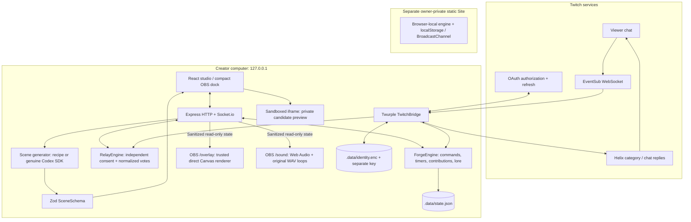

# PopForge architecture

[README](../README.md) · [Setup](SETUP.md) · [Evidence](../judging/EVIDENCE.md)

## Deployment shape

PopForge’s complete runtime is one local Node.js companion bound to `127.0.0.1`, one broadcaster, and a studio plus OBS browser sources on that computer. Twitch transports the actual remote viewer interaction. A separately deployed static Site runs the browser rehearsal transport; it does not run Express, EventSub, credential storage, or a public viewer backend.



## Scene generation and publication

```mermaid
sequenceDiagram
    actor Creator
    participant Studio
    participant API as Local API
    participant Codex as Recipe / Codex SDK
    participant Frame as Private iframe
    participant Engine
    participant OBS
    Creator->>Studio: Describe scene and choose provider
    Studio->>API: Authenticated generate request
    API->>Codex: Supported mechanics + JSON schema
    Codex-->>API: Scene specification or error
    API->>API: Validate again with Zod
    API-->>Studio: Candidate + checks + runtime thread ID
    Studio->>Frame: Bounded scene data
    Frame-->>Studio: Renderer ready
    Creator->>Studio: Publish
    Studio->>API: Publish command
    API->>Engine: Validate and apply; retain rollback history
    Engine-->>API: Updated state
    API-->>OBS: Batched state snapshot
    Note over OBS: Update existing canvas; no browser route reload
```

The generator returns **data**, never executable source. Its specification bounds name/description, four mechanics, four accents, an ASCII keyword, 30–300 seconds, a 5–100 goal, a 1–30 increment, and one of three gravity settings. Recipe mode is deterministic and explicitly selected. Codex mode is serialized to one active generation, times out after 90 seconds, uses an isolated working directory and read-only sandbox, disables subprocess network/web search, and inherits an allowlisted environment excluding Twitch secrets. Errors remain visible.

Private previews use `sandbox="allow-scripts"` without same-origin privileges and a restrictive CSP. The bridge verifies the sending frame window before accepting readiness; generated strings never become executable code. OBS uses the same trusted renderer directly on Canvas to preserve transparency across CEF versions. Calling the OBS route an arbitrary-code sandbox would be inaccurate.

## Authoritative state and interaction

`ForgeEngine` handles schema-validated commands, contribution cooldowns, message deduplication, poll choices/deadlines, rounds, pause/resume, scene history, community memory, moderated kindness, and grounded recaps. A 250 ms timer advances authoritative time. Changes are coalesced into snapshots at a 100 ms boundary rather than emitting an independent visual entity per chatter.

Socket roles are control and viewer. The studio receives full control state. Viewer state omits proposals and pending kindness notes. OBS and sound routes use a stable read-only source token; explicit rotation disconnects old reader sockets. A viewer connection cannot mutate state even if it also presents a valid control cookie. Presence counters measure connected source sockets, not OBS capture, stream status, or Twitch viewer counts.

The real Twitch bridge uses broadcaster OAuth and `user:read:chat` / `user:write:chat`, Twurple refresh and EventSub listeners, channel category metadata, and the Send Chat Message API for cooldown-limited `!recap` replies. Event IDs enter deduplication before contribution acceptance. Public category metadata does not reveal actual gameplay state.

## Persistence and restart behavior

| Data | Storage | Restart behavior |
| --- | --- | --- |
| Scene, recent chat/events, garden, approved lounge state | Atomic `.data/state.json` snapshot | Restored, schema-bounded, recent history capped |
| Host OAuth and source identity | AES-256-GCM `.data/identity.enc`; separate owner-only `.data/identity.key` | Host restore attempted; source token stays stable |
| Private contribution/vote/dedupe ledgers | Process memory | Active rounds return to standby; open polls close; mood vote counts reset |
| Relay guest OAuth, approvals, episode ledgers | Process memory | Fresh invitation and authorization required |
| Browser-only rehearsal | localStorage + BroadcastChannel | Same-profile tabs only; no server/OBS authority |
| Theme, setup visibility, break nudges | Browser-local preferences | Private to that browser profile |

Identity files use owner-only file permissions; the directory is owner-only. Someone controlling the same OS user can obtain both key and ciphertext. This is accidental-sharing protection, not protection against a compromised OS account. Disconnect removes saved host authorization locally without revoking Twitch consent. Graceful shutdown stops EventSub, Relay, Socket.io, HTTP, and the Vite development server.

## Local request boundary

Express caps JSON at 16 KB, validates allowed origins, blocks cross-site API requests, and uses an HttpOnly, SameSite local session cookie. Mutating HTTP requests require a studio request header; socket commands are validated and throttled. OAuth state is expiring, single-use, and bound to the initiating local session. The read-only source token is a bearer capability: do not publish it or include it in videos.

The bootstrap endpoint intentionally establishes local studio control; this architecture is **not** a public authentication or tenant isolation system. A remote service requires HTTPS, durable per-creator identity, tenant separation, production secrets, transport/rate limits, public viewer routing, and operational monitoring.

## Rendering, audio, and accessibility

Visual physics is illustrative; accepted chat and deadlines determine results. Particles, events, recent chat, moderation queues, and visible garden flowers are bounded. Reduced motion, quiet energy, custom keyboard-operable dropdowns, optional studio-only cursor glow, transparent overlays, and an initialization-bound loading animation support comfortable use.

The sound route has opt-in browser playback. Procedural synth and original WAV music coordinate playback to avoid simultaneous music layers; rain/night air can be mixed. OBS routes audio through its mixer. Microphone capture, gameplay vision, stream transcription, and automatic bounty verification are absent.

## Module map

| Module | Responsibility |
| --- | --- |
| `shared/engine.ts` | Scene schema, ten recipes, game engine, garden, polls, event-grounded recaps |
| `shared/lounge.ts` | Validated atmosphere, comfort, break, effects, and kindness state |
| `shared/relay.ts` | Two-community normalized voting, consent, episode lifecycle, isolated load simulation |
| `server/index.ts` | Express/Vite or production host, HTTP/session protections, Socket.io roles, snapshots, shutdown |
| `server/twitch.ts` | Twitch OAuth, token refresh/restore, EventSub, category, chat replies |
| `server/local-identity.ts` | Encrypted persisted host authorization and stable source identity |
| `server/relay.ts` | Guest invitation/auth flow and consent-aware Relay routes |
| `server/generator.ts` | Recipe or genuine SDK scene generation, CLI resolution, environment isolation |
| `src/client.ts` | Companion transport and separate browser-only rehearsal transport |
| `src/SceneFrame.tsx`, `src/renderer.ts` | Private preview bridge and trusted Canvas runtime, including OBS alpha compatibility |
| `src/LiveControls.tsx` | Quick starts, setup status, break controls, OBS dock |
| `src/MemoryGarden.tsx` | Persistent live garden presentation, rehearsal separation |
| `src/Lounge.tsx`, `src/audio.ts`, `src/AudioDock.tsx` | Cozy environment, creator corner, procedural audio and source controls |
| `src/MusicLibrary.tsx`, `scripts/compose-music.mjs` | Original loop selection and reproducible synthesis |
| `src/CreativeKit.tsx`, `src/StudioSelect.tsx`, `src/StudioTheme.tsx` | Downloadable SVGs, custom dropdowns, remembered themes |
| `src/StartupScreen.tsx`, `public/startup.css` | Accessible actual-startup animation |
| `src/Relay.tsx`, `src/relay-load.worker.ts` | Creator Relay UI and explicitly internal simulation |
| `scripts/verify-local.mjs` | Secret-free readiness report without sending chat or invoking generation |
| `tests/` | 41 engine, lifecycle, persistence, API, and authorization regression tests |

See [known limitations](../KNOWN_LIMITATIONS.md) for unverified deployment and scale behavior.
