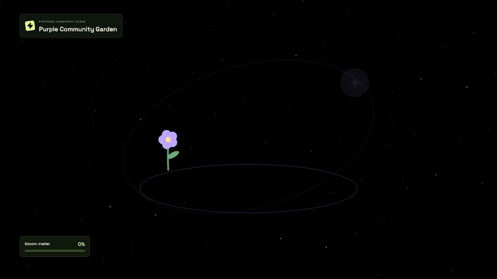
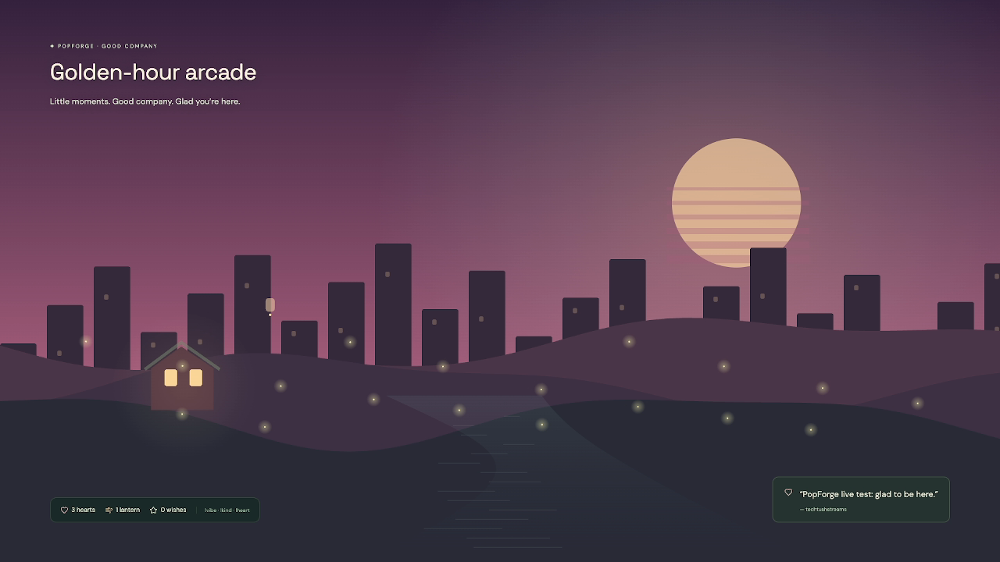
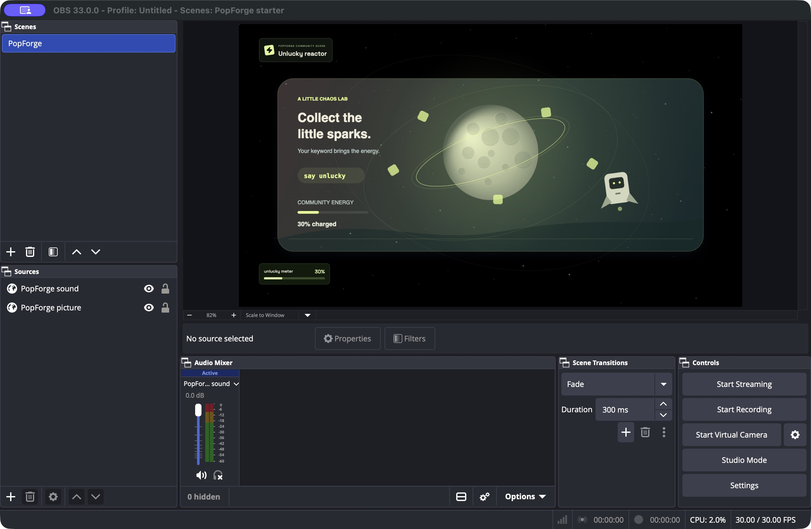

# PopForge evidence ledger

Reviewed through **31 October 2026**. This ledger distinguishes observed behavior, automated checks, and work that has not been exercised. [README](../README.md) · [Architecture](../docs/ARCHITECTURE.md) · [Final review](FINAL_REVIEW.md)

## Automated verification

| Check | Result | Reproduce / scope |
| --- | --- | --- |
| Test suite | **50 passed; 0 failed, skipped, or cancelled** | `npm test`; Node test runner through tsx |
| Type checking and production build | **Passed** | `npm run build`; TypeScript + Vite |
| Clean source installation | **Passed** | Fresh tracked-source archive, `npm ci`, build, and all 41 tests; no `.env` or `.data` copied |
| Dependency audit | **0 known vulnerabilities reported** | `npm audit` on the locked dependency set; time-specific registry advisory check, not a security certification |
| Build performance note | **Earlier warning resolved** | Separate application (~204 KB) and vendor (~373 KB) minified chunks; no startup timing claim |

Tests cover engine deadlines/outcomes, cooldowns, deduplication, poll changes, rollback, scene bounds, grounded recaps, gentle single-chatter participation, garden persistence and rehearsal separation, explicit focus completion, kindness approval/withdrawal, quiet-mode behavior, bounded effects, local API protections, read-only socket roles, credential save/restore and refresh races, stable source links across real process restart, explicit source revocation, CLI selection, and Relay consent/normalization/routing. Twitch service behavior and Codex account generation are separate real checks, not mocked-test claims.

## Real Twitch observations

- The broadcaster `techtushstreams` connected through OAuth and EventSub; the channel category and chat state were read through the integration.
- Earlier broadcaster tests exercised hearts, a free application poll, game contribution, mood suggestion, kindness approval, and a Twitch API recap response.
- The separate `popforgeontwitch` account subsequently supplied real `!shield` and `!heart` messages. The most recent `!heart` updated the community total; the OBS lounge showed three hearts.
- The transient heart burst ended before observation. It was **not** replayed or claimed as captured.
- A real companion restart restored the broadcaster’s remembered authorization and resumed EventSub listening.

These observations prove specific chat/integration behavior. They do not establish concurrent Twitch viewer counts, viewer retention, audience growth, remote Relay, or a completed public broadcast.

## Genuine Codex runtime

Main **development** session: `01a18204-be62-77d1-b0ad-70175ae80ee7`.

A direct SDK request produced Purple Bloom Garden (runtime session `01a18c78-fd71-79c1-8298-2b5b49655a7b`). The complete local studio flow then produced **Purple Community Garden in 14.0 seconds**, showed a ready private preview, and published it (runtime session `01a18c7c-4f21-76f1-a43a-f29d7ddb22bd`). This timing is one observation, not a guarantee.

The installed CLI resolved the bundled CLI’s account-model compatibility failure. No configured model change was required. The runtime result is validated scene data within four trusted mechanics, not arbitrary generated code. Real generation, readiness, and publication passed; the final narrated demonstration of development and Twitch is still pending.

## Actual OBS recording

| Field | Observed value |
| --- | --- |
| Application | OBS Studio 33.0.0, Apple Silicon Mac |
| Visual browser canvas | 1920 × 1080 |
| Recorded output | **1280 × 720, 30 fps, H.264** |
| Duration | **35.43 seconds** |
| Audio | **48 kHz stereo AAC, non-silent** |
| Signal analysis | Mean **−47.9 dB**, peak **−33.9 dB**; quiet music |
| Visual inspection | Extracted frames at 5 and 25 seconds show garden and lounge scene change |
| Finalization | OBS reported successful file finalization |
| Safety/status of rehearsal | Twitch broadcasting off, microphone muted; recording subsequently stopped |

The source alpha issue discovered in OBS was fixed by using the trusted renderer directly on the broadcast canvas; private previews retain their sandboxed iframe. The OBS custom dock, separate audio routing, and mixer signal were exercised.

Audio measurement confirms a signal, not perceptual quality. Final listening balance against narration is still required. No new chat command was captured during this 35-second recording. The MOV and remuxed MP4 are local rehearsal assets; they are not a finished or publicly uploaded submission video. Screenshots above are real extracted frames, not mockups.

## Evidence still absent

- Final under-three-minute YouTube demonstration showing real Twitch interaction and Codex development.
- Judge access to this private repository and confirmed submitted Devpost entry.
- Independent creator setup/adoption pilots, measured retention or growth, production transport/capacity testing.
- Real two-broadcaster Relay with simultaneous chats; secure remote Relay hosting.
- Live validation on operating systems other than the tested Mac.

The first two are submission work. The remaining items constrain claims and roadmap decisions; they are not required additions to the current local product before a truthful hackathon submission.

## 31 October browser design/access follow-up

The owner explicitly authorized public preview access. The GitHub repository remains private. Public preview state is browser-local; real Twitch credentials/state are not deployed. The garden, moon, focus, and reactor share a new illustrated stage treatment. The greenhouse screenshot in README is a real browser rehearsal capture of the updated renderer; the older OBS frames above remain historical recording evidence.

A browser-only sample button was exercised through five accepted garden contributions: the round completed, one rehearsal bloom appeared, and live garden contributions remained zero. The mobile workshop was inspected at 390 × 844: the stage remained visible, its caption moved below the artwork, no white side strips were visible, and document width did not exceed the viewport. Reduced motion and quiet behavior continue to use the existing renderer motion gates. No new real Twitch/OBS recording is claimed for this visual pass.

Application/vendor chunk separation resolves the earlier large-main-chunk warning: approximately 204 KB application and 373 KB vendor, minified. A final build and regression suite accompany the source publication; no startup benchmark or user-retention claim is inferred.

## 31 October community-world, setup, and recovery pass

| Check | Observed result and boundary |
| --- | --- |
| Persistent world | Browser rehearsal earned a seed, opened a choice, selected Moonpond, explicitly approved the build, and reloaded with the place/history retained. Live garden stayed separate. Real Twitch `!grow` has not yet been exercised |
| World integrity | Tests cover one-account changes, broadcaster exclusion, ties/empty votes, late choices, explicit seed spending, fresh live-session persistence, and recap context |
| Recovery | State plus private ledgers survive a real isolated companion process start; duplicate/changed world choices behave correctly. Checksum corruption fails closed and preserves bytes. Owner-only file permissions checked |
| OBS starter | Owner imported and selected the generated collection in OBS 33.0.0. Native screenshot shows PopForge picture/sound and a rendered scene. Companion reported one visual and one audio socket, storage healthy. Isolated test port 14321, Twitch disabled, broadcasting and recording off. This is not new playback or live chat proof |
| Guided observation | `/pilot` starts, accepts observer input, and exports labeled JSON. Empty self-rehearsal export correctly claimed zero completed tasks and no independent participant; reset afterward. No completed independent pilot |
| Local transport | 500 synthetic demo actions, 20 local reader sockets, 500 accepted, all readers converged; 3,045 ms total, median acknowledgment 5.66 ms, p95 9.09 ms. Twitch disabled; zero real viewers. See [raw report](transport-rehearsal.json) |

The transport script measures local HTTP/Socket.io and checkpoint work, not Twitch limits, Internet conditions, OBS render load, or retention. Recovery is bounded and can lose a pending 100 ms Twitch/timer batch on abrupt crash; see the architecture and limitations.
